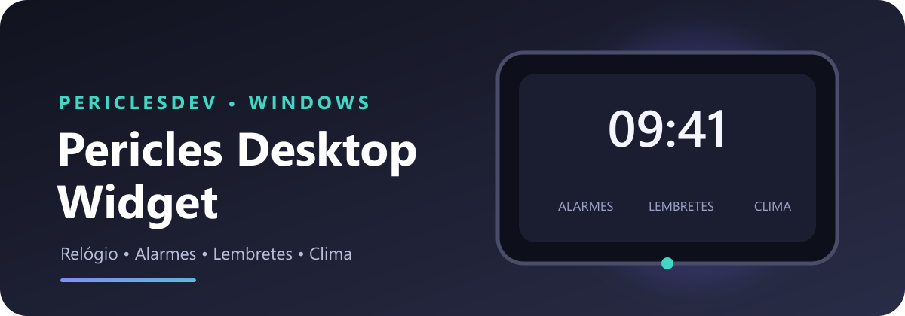
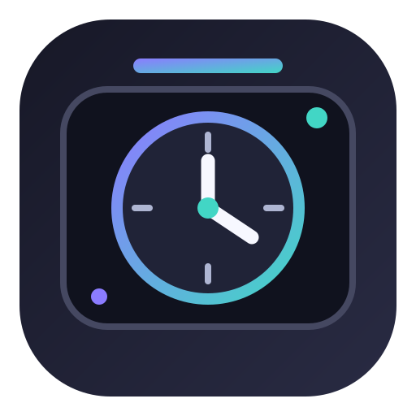

<div align="center">



# Pericles Desktop Widget

### Seu espaço de produtividade diretamente na área de trabalho do Windows.

Um widget desktop desenvolvido para reunir informações e ferramentas úteis em uma interface compacta, moderna e personalizável.

<br>


</div>

---

## 🖥️ Sobre o projeto

O **Pericles Desktop Widget** é um aplicativo para Windows que disponibiliza ferramentas práticas diretamente na área de trabalho, sem depender de abrir um navegador ou acessar diferentes programas.

A proposta é oferecer uma experiência discreta, funcional e de fácil acesso, mantendo as informações importantes sempre à mão.

## ✨ Funcionalidades

- 🕒 **Relógio em tempo real:** visualização da hora diretamente na área de trabalho.
- ⏰ **Alarmes:** configuração de alarmes com aviso sonoro.
- 🔔 **Lembretes:** organização de compromissos e tarefas.
- 🌤️ **Clima:** consulta das condições meteorológicas.
- ⚙️ **Configurações:** personalização das opções disponíveis no aplicativo.
- 📐 **Interface adaptável:** expansão da janela para exibir configurações e informações adicionais.
- 🚀 **Inicialização automática:** possibilidade de iniciar junto com o Windows.

> As funcionalidades podem variar conforme a versão publicada do aplicativo.

## 🎨 Interface

O projeto prioriza uma interface compacta, organizada e intuitiva, com foco em:

- Visual moderno e minimalista.
- Informações apresentadas de forma clara.
- Acesso rápido às funcionalidades.
- Melhor aproveitamento do espaço da área de trabalho.
- Experiência consistente entre as telas.

## 🛠️ Tecnologias utilizadas

| Tecnologia | Finalidade |
|---|---|
| React | Construção da interface |
| TypeScript | Tipagem e segurança do código |
| Vite | Ambiente de desenvolvimento e build |
| Tauri 2 | Aplicativo desktop |
| Rust | Integração com recursos nativos |
| HTML5 | Estrutura da interface |
| CSS3 | Estilização e responsividade |
| JavaScript | Lógica da aplicação |

## 📁 Estrutura do projeto

```text
Desktop-Widget/
│
├── docs/
│   └── assets/
│       ├── app-icon.svg
│       ├── app-icon.png
│       ├── readme-banner.svg
│       └── readme-banner.png
│
├── src/
│   ├── assets/
│   ├── components/
│   ├── hooks/
│   ├── styles/
│   └── ...
│
├── src-tauri/
│   ├── icons/
│   │   ├── pericles-icon.svg
│   │   ├── 32x32.png
│   │   ├── 128x128.png
│   │   ├── 128x128@2x.png
│   │   └── icon.ico
│   │
│   ├── src/
│   ├── capabilities/
│   └── tauri.conf.json
│
├── package.json
├── package-lock.json
├── tsconfig.json
└── README.md
```

## 💻 Requisitos

Para executar o projeto em ambiente de desenvolvimento, você precisará de:

- Windows 10 ou Windows 11.
- Node.js.
- npm.
- Rust.
- Dependências de desenvolvimento do Tauri para Windows.

## 🚀 Instalação e execução

### 1. Clonar o repositório

```bash
git clone https://github.com/Pericles-cmyk/Desktop-Widget-.git
```

### 2. Entrar na pasta

```bash
cd Desktop-Widget
```

### 3. Instalar dependências

```bash
npm install
```

### 4. Executar em desenvolvimento

```bash
npm run tauri dev
```

### 5. Gerar a versão de produção

```bash
npm run tauri build
```

Os instaladores e executáveis gerados ficarão disponíveis dentro da pasta de build do Tauri.

## 🖼️ Identidade visual

Os arquivos de identidade visual do aplicativo ficam organizados em:

- `src-tauri/icons/`: ícones utilizados na aplicação desktop.
- `docs/assets/`: imagens utilizadas na documentação e no README.

Os arquivos SVG são mantidos como originais editáveis. As versões PNG e ICO são utilizadas nos locais que exigem formatos específicos.

## 🔄 Desenvolvimento

O projeto utiliza Git para controle de versão.

Fluxo recomendado:

1. Desenvolver novas funcionalidades.
2. Testar localmente.
3. Corrigir erros encontrados.
4. Executar o build de produção.
5. Realizar commit das alterações.
6. Enviar as alterações para o GitHub.

## 👨‍💻 Desenvolvido por

<div align="center">



### PericlesDev

**Desenvolvimento de soluções digitais e aplicações personalizadas.**

[](https://github.com/Pericles-cmyk)

[](https://periclesdev.com.br)

</div>

---

<div align="center">

**Pericles Desktop Widget — Tecnologia e produtividade em um só lugar.**

</div>